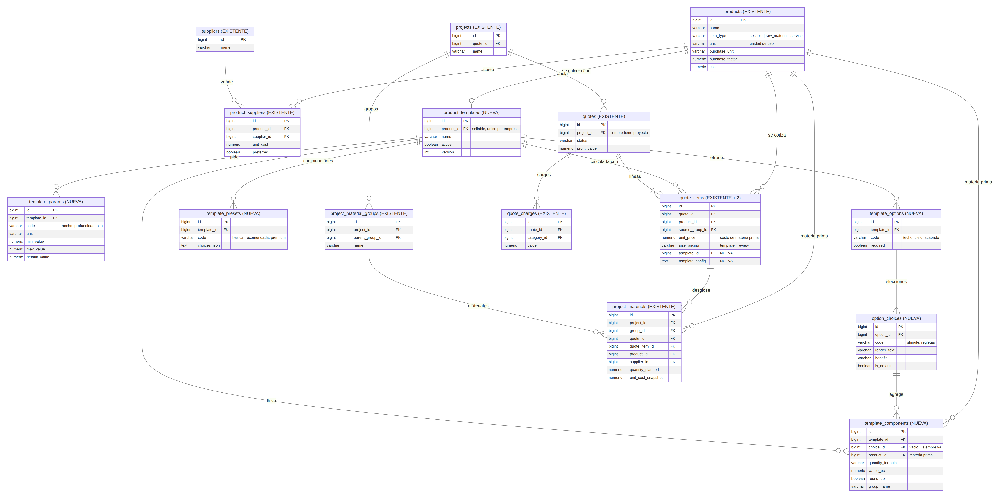

# Stackline · Servicios

Contexto del proyecto y reglas de trabajo: [AGENTS.md](AGENTS.md).

## Modelo de datos: plantillas de cálculo por producto

Un producto vendible a la medida (p. ej. una pérgola) tiene una plantilla que,
con los parámetros del cliente (ancho, profundidad, alto) y las opciones de
diseño que elige (techo, cielo, acabado), calcula la materia prima con sus
cantidades y costo, y el texto con el que el asistente dibuja el render.
Migraciones `084_product_templates.sql` y `085_template_materials_only.sql`.

- La materia prima calculada entra a `project_materials` del proyecto de la
  cotización, estampada con `quote_id` y `quote_item_id`: de ahí la cotización
  saca su costo y el proyecto su lista de compras.
- La plantilla describe solo materiales. La mano de obra y los demás costos
  se agregan en la cotización como cargos (`quote_charges`).
- La ganancia, el gasto operativo y el IVA los pone la cotización, igual que
  en cualquier línea.

Fuente editable del diagrama (Mermaid): [docs/diagramas/plantillas-er.mmd](docs/diagramas/plantillas-er.mmd).

---

## Micronaut 5.0.2 Documentation

- [User Guide](https://docs.micronaut.io/5.0.2/guide/index.html)
- [API Reference](https://docs.micronaut.io/5.0.2/api/index.html)
- [Configuration Reference](https://docs.micronaut.io/5.0.2/guide/configurationreference.html)
- [Micronaut Guides](https://guides.micronaut.io/index.html)
---

- [Shadow Gradle Plugin](https://gradleup.com/shadow/)
- [Micronaut Gradle Plugin documentation](https://micronaut-projects.github.io/micronaut-gradle-plugin/latest/)
- [GraalVM Gradle Plugin documentation](https://graalvm.github.io/native-build-tools/latest/gradle-plugin.html)
## Feature serialization-jackson documentation

- [Micronaut Serialization Jackson Core documentation](https://micronaut-projects.github.io/micronaut-serialization/latest/guide/)

## Feature micronaut-aot documentation

- [Micronaut AOT documentation](https://micronaut-projects.github.io/micronaut-aot/latest/guide/)

